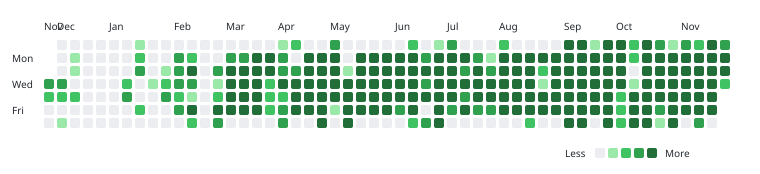

<!--START_SECTION:waka-->


**Coding Activity**



**I'm an Early 🐤** 

```text
🌞 Morning                654 commits         ████████░░░░░░░░░░░░░░░░░
🌆 Daytime                1301 commits        ████████████████░░░░░░░░░
🌃 Evening                1019 commits        █████████████░░░░░░░░░░░░
🌙 Night                  167 commits         ██░░░░░░░░░░░░░░░░░░░░░░░
```
📅 **I'm Most Productive on Thursday** 

```text
Monday                   501 commits         ██████████████████░░░░░░░
Tuesday                  386 commits         ██████████████░░░░░░░░░░░
Wednesday                531 commits         ███████████████████░░░░░░
Thursday                 677 commits         ████████████████████████░
Friday                   507 commits         ██████████████████░░░░░░░
Saturday                 304 commits         ███████████░░░░░░░░░░░░░░
Sunday                   235 commits         ████████░░░░░░░░░░░░░░░░░
```


**I Mostly Code in C++** 

```text
C++                      6 repos             █████████████████████░░░░
Go                       4 repos             ██████████████░░░░░░░░░░░
Python                   3 repos             ███████████░░░░░░░░░░░░░░
Swift                    2 repos             ███████░░░░░░░░░░░░░░░░░░
JavaScript               2 repos             ███████░░░░░░░░░░░░░░░░░░
```


 Last Updated on 24/11/2026 04:02:21 UTC
<!--END_SECTION:waka-->
